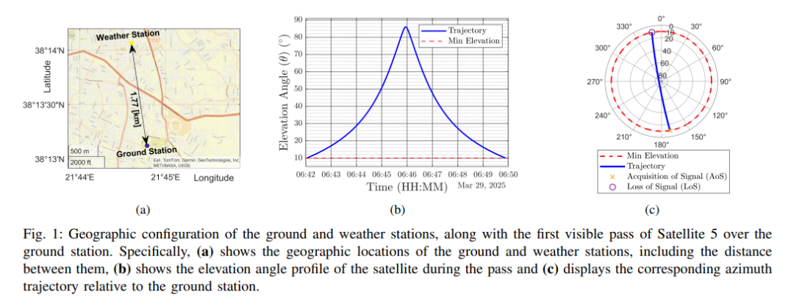
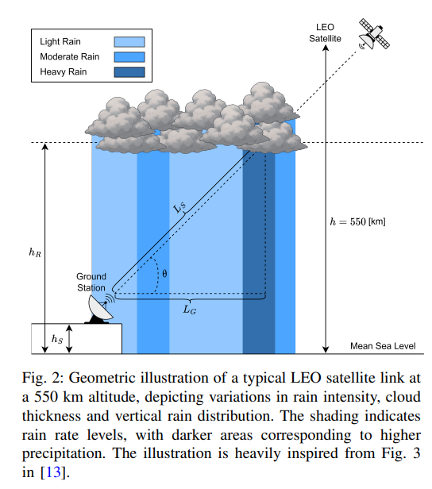
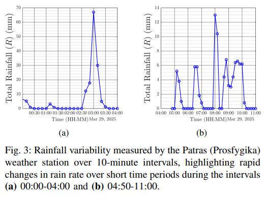
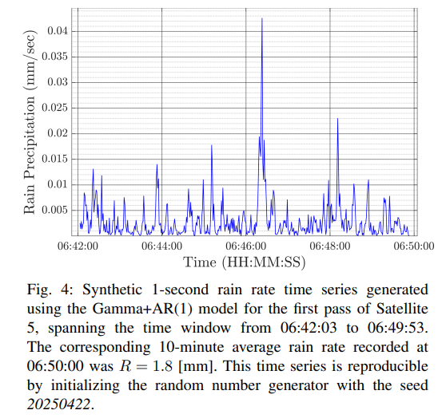
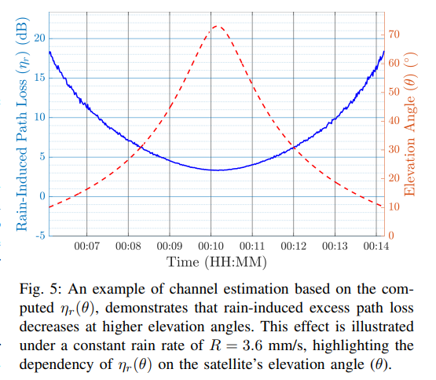
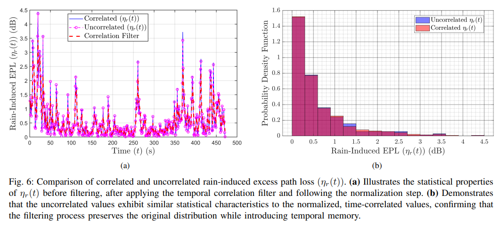
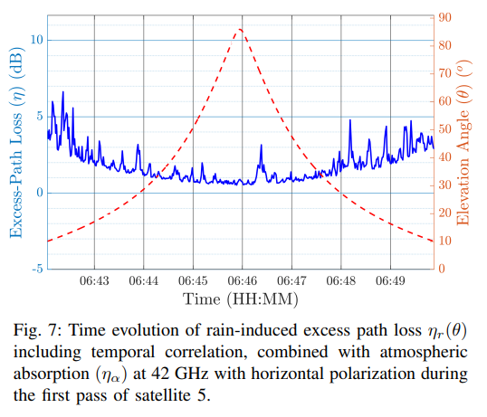
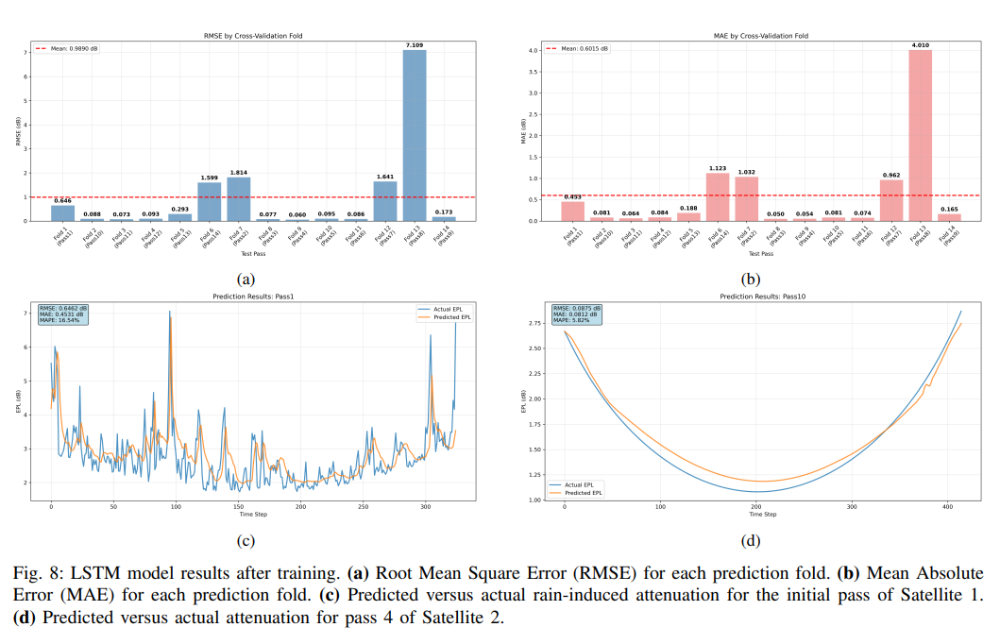
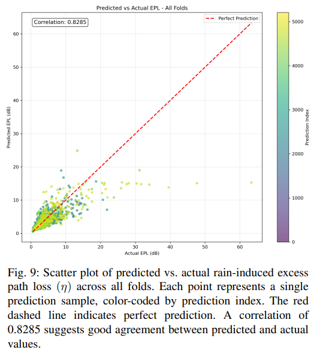

# [LEO] Deep Learning-Based Simulation Framework for Predicting Additional Path Loss in Low Earth Orbit Satellite Links over Q/V Bands [with MATLAB Code]

1. Summary
As the demand for high-throughput and low-latency communication continues to grow, the deployment process of Low Earth Orbit (LEO) satellite constellations has significantly accelerated. The Q/V band, due to its wider bandwidth capacity, has attracted widespread attention. However, signals in this frequency band are highly susceptible to atmospheric interference, with rainfall attenuation being particularly prominent.
This study proposes a simulation-based framework to predict extra path loss (EPL) caused by cloud, atmospheric absorption, and rainfall attenuation in the low-orbit satellite communication links within the Q/V band. The framework consists of a fixed ground station and five simulated low-orbit satellites, with their orbit trajectories defined by Kepler elements and orbit propagation calculated using the SGP4 algorithm.
The research team processed local meteorological station rainfall data and synchronized it with the satellite transit time to estimate the extra path loss caused by rainfall, subsequently combining other atmospheric factors to obtain the total extra path loss. These data were used to train a Long Short-Term Memory (LSTM) neural network. The results show that the proposed model successfully captures the time-varying characteristics of rainfall fading, achieving precise predictions of extra path loss under different atmospheric conditions.
2. Introduction
Satellite communication systems have become an indispensable part in expanding communication connectivity in areas where ground infrastructure is insufficient [1]. To meet the growing demand for high-capacity and low-latency links, industries have turned towards large-scale Low Earth Orbit (LEO) satellite constellations, with projects such as Starlink, IRIS², Eutelsat OneWeb, Thales Aerospace's ThalesOne, and State Grid Corporation of China [6][7] being representative examples.
The rapid deployment of low-Earth orbit (LEO) satellites, coupled with the continuous increase in demand for high-speed and low-latency communication [8], as well as the ongoing application of geostationary Earth orbit (GEO) and geostationary transfer orbit (GTO) systems, has led to a growing congestion problem in traditional satellite communication (SATCOM) frequency bands (L, S, C, X, Ku, and Ka bands). Against this backdrop, research has increasingly focused on higher frequency bands such as Q/V bands. These bands not only offer greater data throughput but are also considered ideal choices for next-generation satellite constellations [9]-[11].
However, it is important to note that signals in the Q/V bands are more susceptible to atmospheric attenuation caused by factors such as rainfall, cloud cover, and gas absorption [12]. To address this issue, recent research has been dedicated to developing real-time prediction methods for weather-induced fading using machine learning, aiming to achieve link adaptation optimization to ensure that satellite communication performance remains stable under changing weather conditions while minimizing resource consumption [13][14].
This study constructs a simulation scenario including a fixed ground station and multiple LEO satellites using long short-term memory (LSTM) neural networks to predict extra path loss (EPL) caused by cloud effects, atmospheric absorption, and rainfall attenuation. The second part of the paper elaborates on the configuration of the ground station and the use of Kepler elements to simulate the trajectories of five LEO satellites; the third part introduces the process of handling local meteorological station rainfall rate data and aligning it with corresponding satellite transit times; the fourth part details the method of estimating dB level extra path loss based on satellite elevation angle and rainfall rate; and the fifth part demonstrates how satellite data can be integrated with rainfall data into an LSTM model, achieving predictions for future extra path loss due to rainfall attenuation during satellite transit through model training. The development of this study has been greatly inspired by the findings of the authors in [13].
III. Conclusions The research results indicate that the model based on Long Short-Term Memory (LSTM) can effectively support adaptive link adjustment with predictive and weather perception capabilities. This capability provides a highly valuable tool for optimizing satellite link electronic design and signal processing strategies, helping to maintain satellite communication performance at near optimal levels.
At the same time, this model is also a key driver in advancing the development of next-generation satellite communication (SATCOM) architecture. In the next generation of satellite communication architecture, facing rapidly changing atmospheric conditions, the adaptability and robustness of the communication system are core elements for ensuring reliable operation. The model proposed in this study precisely meets this core requirement, laying an important foundation for the development of next-generation satellite communication technology.

## Images

<!-- PAYMENT_BLOCK -->

## Get this dataset

- Payment link (Stripe): [Buy now](https://buy.stripe.com/3cs8yP7sY87d0vu9AB)
- Payment QR code: 

<!-- /PAYMENT_BLOCK -->
